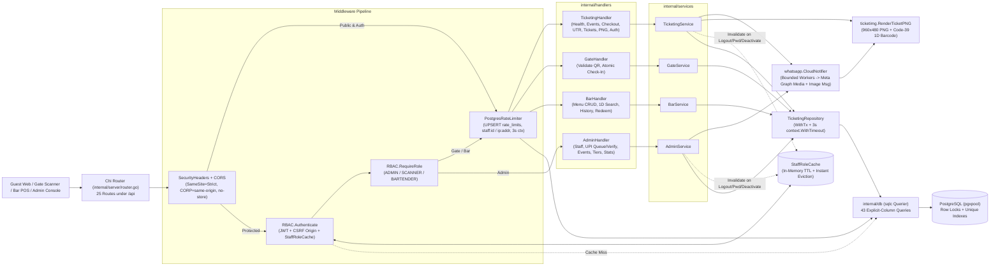
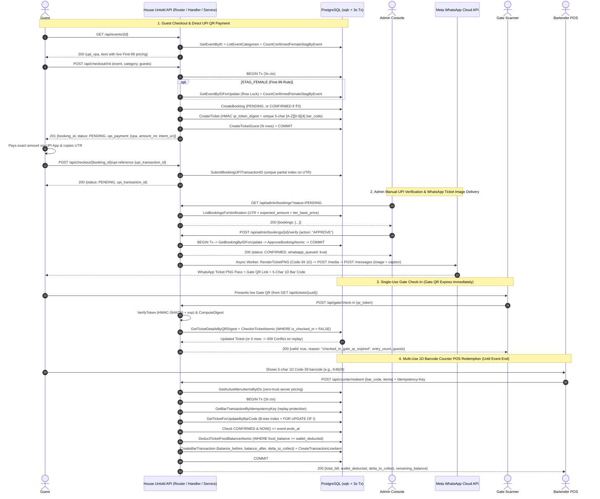

# House Untold Backend Architecture (Latest State)

Direct UPI QR + Manual Admin Verification + WhatsApp Cloud PNG Ticket Pass + Dual Barcodes (Single-Use HMAC Gate QR + Multi-Use 5-Char Code-39 1D Bartender Barcode).

## 1. Backend Architecture

## 2. End-to-End Sequence Diagram (Direct UPI -> Admin Verify -> WhatsApp PNG -> Gate -> Bar)

